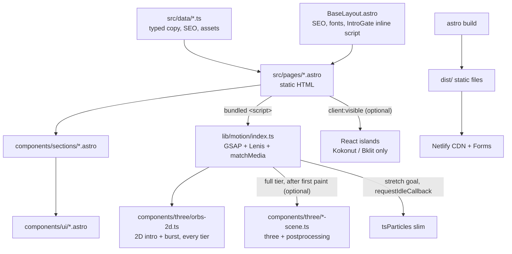

# Engineering Plan — Aden Khan Portfolio

> **For agentic workers:** each milestone below is one prompt of the owner's prompt pack (p08–p22). Execute one milestone per prompt with `superpowers:executing-plans`, verify with the milestone's commands, then commit with the milestone's message. Steps use checkbox (`- [ ]`) syntax.

**Goal:** a static, four-page Astro portfolio for Aden Khan that passes the course rubric, reads perfectly without JavaScript, and layers the motion system from `docs/MOTION.md` on top.

**Architecture:** Astro static output (multi-page, no client router). Pages are `.astro` components fed by typed data files; interactivity is small bundled `<script>` modules, not React, unless a component can only exist in React. Motion is one module (`src/lib/motion`) that boots per page. ~~3D is a lazy chunk used only by the intro and the CV burst.~~ Round 2: 3D is a core, persistent WebGL scene behind every page (see "Round 2 rules" and §6).

**Tech stack:** Astro 7.4.4, Tailwind v4.3.3, React 19.3.1 (islands only), GSAP 3.15.0 (+ ScrollTrigger, SplitText, ScrambleText, CustomEase), Lenis 1.3.27, three 0.187.0 + postprocessing 6.39.6 (lazy; core from Round 2), custom GLSL, @react-three/fiber, @react-three/drei and @react-three/postprocessing (allowed from r1; installed by the prompt that first uses them), @tsparticles/slim 4.5.0, Playwright, Netlify.

**Spec:** `docs/00-design-plan.md` (copy, SEO table, wireframe), `docs/01-brief.md` (success criteria), `DESIGN.md` (tokens, components), `docs/MOTION.md` (motion), `CLAUDE.md` (non-negotiables). Read the relevant one before each milestone.

## Global constraints
Copied from the spec; every milestone includes them.
- Routes: `/`, `/about`, `/work`, `/contact`, `/404`, plus `/thanks` (form confirmation, `noindex`). Separate pages, not one scroll.
- All meaningful text is real HTML, never baked into images or canvas. The site is fully readable with JavaScript disabled.
- Every page: unique `<title>`, meta description, exactly one H1 containing a target keyword, Open Graph tags, canonical URL. Title, description and H1 values come verbatim from the SEO table in `docs/00-design-plan.md` §5.
- Every image has descriptive alt text; decorative images use `alt=""`.
- `prefers-reduced-motion: reduce`: no intro, no parallax, no large movement; static versions of every effect. This is the only setting that makes an effect static.
- Works at 360px wide with no horizontal scroll. Body text ≥ 16px. Tap targets ≥ 44px.
- Intro: under 3 s, once per browser session (`sessionStorage["ak.intro"]`), Skip visible from the first frame, Esc skips.
- Hero image is the illustrated avatar (no photo). No franchise characters, logos, names or named techniques.
- Facts only from `docs/cv-source.md`. The phone number never appears on the site.
- Budgets (Round 2):
  - Lighthouse Performance: desktop ≥ 75, mobile ≥ 65.
  - Lighthouse SEO ≥ 95, Accessibility ≥ 95, Best Practices ≥ 95.
  - LCP < 2.5 s, CLS < 0.1, INP < 200 ms.
  - Entry (first-load) JS < 150 KB gzip. Lazily loaded 3D and visual chunks have no size limit.
  - The first paint shows real HTML text.
  - Before r1 the targets were mobile Performance ≥ 85, with lazy chunks counted in the 150 KB.
- Word budgets (Round 2), counting visible words in `<main>`: Home ≤ 80, About ≤ 160, Work ≤ 60 per case study, Contact ≤ 40. Each fact appears once on the site; BBA/IBA only in the About education chip (plus meta and JSON-LD).
- Deploy to Netlify (GitHub Pages as backup). Never Vercel.
- Definition of done (CLAUDE.md §7): `astro check` and `npm run build` pass, no console errors, checked at 375px and 1440px, reduced motion checked, docs updated, one commit per milestone (`pNN: <name>`).

## Round 2 rules (r1, 2026-11-02)
The p08–p16 build passed its gates but failed the owner's vision. The evidence and the rule behind every cut are in `docs/audits/round2-baseline.md`. From r1 on, the rules below override the rest of this plan where they conflict. Their canonical text is in `CLAUDE.md` §4a and `docs/MOTION.md` §0.

1. **Visual first, with word budgets.** Each section leads with a visual or motion moment. Add a test, owned by the first Round 2 page prompt, that counts visible words in `<main>` per page and per `[data-case-study]`, and fails over budget.
2. **Each fact once.** Add a test that reads the built HTML's visible text and fails when a registered fact appears more than once: "BBA", "IBA Karachi" outside the education chip and the availability line ("mid-2027"). Meta, JSON-LD and the CV dialog are excluded. The headline metrics are exempt by the owner's r2 copy (`CLAUDE.md` §4a). **Built in r2:** `tests/e2e/copy.spec.ts` (word budgets, these facts once, case-study lines one line at 1440 px).
3. **3D core and persistent.** (Built in r3 with option (a); `docs/MOTION.md` §13.) A single WebGL scene sits behind every page. It mounts once per page load, is fixed and full-viewport at `z-index` below content, and ignores pointer events except for the regions R3 defines. R3 decides between:
   - (a) adopting Astro `<ClientRouter />` with `transition:persist` on the canvas, so the scene survives navigation;
   - (b) keeping MPA navigation and restoring the scene's state per page.

   The recommended choice is (a), because rebuilding a WebGL context on every navigation flashes and costs 100–300 ms. Choosing (a) reopens ADR-001, and the decision must be logged.
4. **Lower quality, never remove.** Quality tiers set DPR, counts, shader variant, postprocessing resolution and idle frame rate. No tier other than `reduced` (static) and "no usable WebGL" (2D or poster) may skip an effect.
5. **Budgets.** See "Global constraints". (Done in r3.) Update `scripts/check-budget.mjs` in R3 or earlier so that it measures entry chunks only against 150 KB and reports lazy chunk sizes without failing. Lighthouse desktop ≥ 75 and mobile ≥ 65 become the performance gate.
6. **Libraries.** R3F, drei and `@react-three/postprocessing` are allowed; ADR-002's "no required islands" no longer binds the 3D scene. A React root that exists only for the canvas may load lazily (`client:only="react"` or a dynamic import) as long as the entry JS stays under 150 KB.

## Review focus
Inputs the spec implies but no happy-path test covers. Each has a test in the milestone that owns the code.
1. **Coming back within the session**, including browser Back from another page (bfcache restore): the intro must not replay and the overlay must never stay on screen. Test in p11.
2. **JavaScript disabled, or a script throws**: every heading and paragraph is visible; nothing is left at `opacity: 0` or `visibility: hidden` by a pre-JS style. Test in p10 and p20.
3. **Storage blocked** (Safari private mode, `sessionStorage` throws): the intro does not play and the page does not error. Test in p11.
4. **Long words at 360px** ("cannibalization", "$7,000+", "Go-to-market (2025–26)"): no horizontal scroll on any route. Test in p09 and p20.
5. **Assets not delivered yet** (avatar, screenshots, CV PDF): placeholders render, no broken images, and the CV button never links to a missing file. Test in p08 (data) and p12 (dialog).

---

## 1. Architecture



**Default: `.astro` components with zero JavaScript.** Interactivity that a few lines of DOM code can do (mobile menu, CV dialog, gallery buttons, count-ups, motion) lives in bundled `<script>` tags inside the `.astro` component or in `src/lib/motion`. Astro bundles and defers these as modules.

**React islands: none are required.** A React component is used only when the thing cannot exist without React (a Kokonut or Bklit registry component). A React component rendered without a `client:*` directive outputs static HTML with no JavaScript, so shadcn primitives may be used that way.

| Component | Kind | Directive | Justification |
|---|---|---|---|
| Nav, MobileMenu, Footer, SkipLink, SEO | `.astro` + small script (menu only) | none | Static markup; the menu toggle is about 20 lines of DOM code |
| Hero, CharacterCard, StatsStrip, Teaser | `.astro` | none | Content; motion attaches from `lib/motion` |
| CvDialog | `.astro` with native `<dialog>` | none | Native focus trap and Esc; keeps Home free of React (budget) |
| OriginArc, MissionGrid, SkillsTree, CreativeGallery | `.astro` | none | Content; scroll-snap gallery needs no JS |
| TerminalPanel, ContactForm | `.astro` | none | Netlify Forms needs a static HTML form in the built output |
| IntroOverlay | `.astro` + inline head script (`IntroGate`) | none | Must run before first paint; an island would hydrate too late |
| `ui/button.tsx` (shadcn, existing) | React, static | none | Only if reused; renders to HTML with no JS |
| Optional Kokonut component chosen in p16 | React island | `client:visible` | Registry component exists only in React; below the fold, so hydrate on view |
| Optional pointer-only Kokonut effect | React island | `client:media="(hover: hover) and (pointer: fine)"` | Never downloaded on touch devices |
| Optional Bklit chart (Work) | React island | `client:visible` | Only if p16 adds a chart; below the fold |

`client:load` and `client:idle` are not used: nothing above the fold needs React, and idle hydration would still count toward first load on Home.

### Architecture decisions (ADR summaries)
**ADR-001 Static multi-page Astro, no `<ClientRouter />`.** Accepted. Context: the rubric needs four real pages; `docs/MOTION.md` chose native cross-document view transitions. Alternatives: Astro's ClientRouter (SPA-like transitions, persistent state) was rejected because it adds JS, forces every script to handle `astro:page-load` and `astro:before-swap` re-init and cleanup, and complicates Lenis, ScrollTrigger and the session-gated intro. Consequence: each navigation is a full document load; motion boots fresh per page; the browser crossfades with `@view-transition { navigation: auto; }`; unsupported browsers navigate instantly. **Superseded in r3:** `<ClientRouter />` is adopted so the 3D world persists across pages (`transition:persist`). Pages are still separate routes and documents for no-JS visitors and search engines. Component scripts re-initialise through `src/lib/page.ts` (`onPage`: run now and on every `astro:page-load`, clean up on `astro:before-swap`); BaseLayout restores the motion gate on `astro:after-swap`; the Netlify form opts out with `data-astro-reload`.

**ADR-002 No required React islands.** Accepted. Context: 150 KB first-load budget, about 45–60 KB of which React would take. Alternative: building sections in React for convenience. Consequence: interactivity is vanilla TypeScript; React appears only for registry components, always deferred. **Round 2 (r1): relaxed.** The persistent 3D scene may use React Three Fiber in a lazily loaded root; entry JS still stays under 150 KB. **r3:** not needed. The world is plain Three.js, so there are still no React islands.

**ADR-003 Copy in typed TypeScript, not content collections.** Accepted. Context: four pages, fixed copy, no Markdown authoring. Alternative: Astro content collections with Zod. Rejected as more machinery than the content needs; plain `as const` objects with interfaces give type safety and one place to edit.

**ADR-004 Netlify hosting.** Accepted. Required by the rubric (Vercel not allowed); Netlify Forms gives a free contact form. GitHub Pages stays as a static backup (no forms there; the mailto fallback covers it).

## 2. Folder structure

```
src/
  pages/
    index.astro            about.astro          work.astro
    contact.astro          thanks.astro         404.astro
    robots.txt.ts          # builds robots.txt from Astro.site
  layouts/
    BaseLayout.astro       # <html>, <SEO>, fonts, IntroGate, nav, footer, <slot/>
  components/
    layout/  Nav.astro  MobileMenu.astro  Footer.astro  SkipLink.astro  SEO.astro  IntroGate.astro
    sections/
      home/     Hero.astro  CharacterCard.astro  StatsStrip.astro  Teaser.astro
      about/    Bio.astro  OriginArc.astro  ArcPanel.astro  Education.astro  CareerGoals.astro
      work/     MissionGrid.astro  MissionCard.astro  SkillsTree.astro  CreativeGallery.astro
      contact/  TerminalPanel.astro  ContactForm.astro
    ui/      Button.astro  LaneTag.astro  CvDialog.astro  Img.astro  VisuallyHidden.astro  button.tsx (existing)
    motion/  IntroOverlay.astro  CvBurstHost.astro
    three/   capability.ts  intro-scene.ts  burst-scene.ts  dispose.ts  orbs-2d.ts
  data/
    types.ts  site.ts  home.ts  missions.ts  skills.ts  timeline.ts  seo.ts  assets.ts
  lib/
    utils.ts (existing)
    motion/
      index.ts  tier.ts  eases.ts  lenis.ts
      moments/  intro.ts  cv-reveal.ts  headline.ts  panels.ts  countup.ts
                skills-tree.ts  contact-prompt.ts  particles.ts (stretch goal only)
  styles/
    global.css             # tailwind, @theme tokens from DESIGN.md, shadcn variable mapping
    fonts.css              # Fontsource imports
  assets/
    avatar/  placeholder.svg      (real avatar.png arrives later)
    gallery/ .gitkeep             (screenshots arrive later)
    og/      default.png home.png about.png work.png contact.png   (1200x630, p18)
public/
  favicon.svg  favicon.ico  apple-touch-icon.png
  cv/  .gitkeep                   (aden-khan-cv.pdf arrives later)
tests/
  e2e/  smoke.spec.ts  responsive.spec.ts  reduced-motion.spec.ts  a11y.spec.ts
        no-js.spec.ts  intro.spec.ts  cv-dialog.spec.ts  form.spec.ts
scripts/
  check-budget.mjs                # fails the build if first-load JS > 150 KB gzip
docs/
  00-design-plan.md  01-brief.md  cv-source.md  MOTION.md  ENGINEERING-PLAN.md
  SEO.md  DECISIONS.md  SKILLS-AND-TOOLS.md  design-canvas/
DESIGN.md  CLAUDE.md  AGENTS.md  netlify.toml  playwright.config.ts  .prettierrc
```

## 3. Data layer

Pages and sections never contain copy. Every string comes from `src/data`. Strings are copied word for word from `docs/00-design-plan.md` §6.

```ts
// src/data/types.ts
export type Lane = "creative" | "data" | "both";
export type PageId = "home" | "about" | "work" | "contact" | "thanks" | "404";

export interface NavItem { label: string; href: `/${string}` | "/"; }
export interface Link { label: string; href: string; external?: boolean; }

export interface SiteConfig {
  name: "Aden Khan";
  role: "Product Marketer";
  location: "Karachi, Pakistan";
  url: string;                       // canonical origin, also Astro `site`
  email: string;
  linkedin: string;
  github: string;
  nav: NavItem[];
  hudTag: string;                    // "// PLAYER 01 · PRODUCT MARKETER · KARACHI"
  footer: { copyright: string };
}

export interface Stat {
  value: number;                     // 72, 40, 7000, 4: what the ticker counts to
  prefix?: string;                   // "−", "+", "$"
  suffix?: string;                   // "%", "+"
  display: string;                   // "−72%": exact text in the HTML
  label: string;
  lane: Lane;
}

export interface HomeCopy {
  h1: string; subhead: string;
  availability: string;              // "BBA Marketing student at IBA Karachi. Open to internships now and full-time roles from mid-2027."
  ctaPrimary: string; ctaSecondary: string;
  statBars: [string, string, string, string];
  stats: [Stat, Stat, Stat, Stat];
  teaser: string;
}

export interface Mission {
  id: string;                        // kebab-case slug
  order: number;                     // 1–9, as in the design plan
  title: string; org: string; role?: string; result: string;
  lane: Lane;
  related: Link;                     // section with the longer story, e.g. /about/#arc-growth (docs/SEO.md §9)
  evidence?: AssetKey;               // screenshot slot, optional
}

export interface SkillLane { id: "product" | "growth" | "data" | "creative"; label: string; lane: Lane; skills: string[]; }

export interface Arc { order: 1 | 2 | 3 | 4; title: string; period: string; text: string; lane: Lane; }

export interface AboutCopy {
  h1: string; bio: string; arcs: [Arc, Arc, Arc, Arc];
  education: { school: string; degree: string; years: string; courses: string[]; certification: string };
  goals: string;
}

export interface ContactCopy { h1: string; line: string; prompt: string; }

export interface PageSeo {
  id: PageId; path: string; title: string; description: string;
  h1: string; h1Sub?: string;        // visible second line inside the H1 (About, Contact)
  ogImage?: string; ogImageAlt?: string; noindex?: boolean;
}

export type AssetKey = "avatar" | "cvPdf" | "ogDefault" | `gallery-${string}`;
export interface AssetSlot {
  key: AssetKey;
  status: "placeholder" | "ready";
  src: ImageMetadata | string;       // placeholder until the real file is added
  alt: string;                       // from docs/SEO.md
  width: number; height: number;
}
```

| File | Exports |
|---|---|
| `site.ts` | `site: SiteConfig` |
| `home.ts` | `home: HomeCopy` |
| `missions.ts` | `missions: Mission[]` (9, in plan order). Lanes: 1 both, 2 data, 3 creative, 4 data, 5 data, 6 data, 7 both, 8 creative, 9 creative |
| `skills.ts` | `skillLanes: SkillLane[]` (product → both, growth → creative, data → data, creative → creative) |
| `timeline.ts` | `about: AboutCopy` (bio, four arcs: 1 creative, 2 both, 3 data, 4 both; education, goals); `contact: ContactCopy` |
| `seo.ts` | `seo: Record<PageId, PageSeo>` (values from design plan §5; `thanks` and `404` are `noindex`) |
| `assets.ts` | `assets: Record<AssetKey, AssetSlot>`; `cvAvailable(): boolean` (true only when `cvPdf.status === "ready"`) |

## 4. SEO layer

`src/components/layout/SEO.astro`, rendered once inside `<head>` by `BaseLayout`:

```ts
interface Props {
  title: string; description: string;
  canonical?: string;         // default: new URL(Astro.url.pathname, Astro.site)
  ogImage?: string;           // default: assets.ogDefault, absolute URL
  noindex?: boolean;          // adds <meta name="robots" content="noindex, nofollow">
  jsonLd?: Record<string, unknown> | Record<string, unknown>[];
}
```
Outputs: `<title>`, meta description, canonical link, Open Graph (`og:type website`, `og:title`, `og:description`, `og:url`, `og:image`, `og:image:width/height`, `og:site_name`), Twitter `summary_large_image`, theme-color `#0B0D1A`, and one `<script type="application/ld+json">` per item (`set:html={JSON.stringify(item)}`).

- **Site URL:** one constant, `SITE_URL = "https://aden-khan-portfolio.netlify.app"` in `src/data/site.ts`, imported by `astro.config.mjs` as `site`. p21 replaces it with the live URL and records it in `DECISIONS.md`. `trailingSlash: "always"`, `build.format: "directory"`.
- **Preview indexing:** `<SEO>` adds `noindex, nofollow` when `process.env.CONTEXT` is set and is not `production` (Netlify deploy previews and branch deploys).
- **Per-page OG images:** `og/home.png`, `og/about.png`, `og/work.png`, `og/contact.png` (1200×630, p18), falling back to `og/default.png`. Full tag list and alt text in `docs/SEO.md` §6.
- **Sitemap:** `@astrojs/sitemap` with `filter: (p) => !/\/(thanks|404)\/?$/.test(p)`.
- **robots.txt:** `src/pages/robots.txt.ts` returns `User-agent: *`, `Allow: /`, `Sitemap: <site>/sitemap-index.xml`.
- **JSON-LD:** one block per page. Home: one `@graph` with `WebSite` and `Person` (`@id` `<SITE_URL>/#person`; `name`, `jobTitle`, `url`, `email`, `address`, `alumniOf`, `sameAs`). About: `ProfilePage` with `mainEntity` referencing the Person `@id`. Work and Contact: none. Exact JSON in `docs/SEO.md` §7.
- Titles, descriptions, H1s (including the About and Contact H1 sublines), H2 structure, alt text, internal links and the pre-launch checklist are specified in `docs/SEO.md`.

## 5. Motion layer

One entry, `src/lib/motion/index.ts`:

```ts
export type MotionTier = "full" | "lite" | "reduced";
export interface MotionHandle { tier: MotionTier; lenis: Lenis | null; destroy(): void; }
export function initMotion(page: PageId): MotionHandle;
```
- `tier.ts`: `getTier(): MotionTier` (rules from `docs/MOTION.md` §1), writes `document.documentElement.dataset.motion`.
- `eases.ts`: registers `ScrollTrigger` and `CustomEase` exactly once (module-level guard), creates `ui-out` (`0.23,1,0.32,1`) and `ui-in-out` (`0.77,0,0.175,1`). `SplitText` and `ScrambleText` are registered by the moments that use them (Home, Contact), so they never ship on About or Work.
- `lenis.ts`: `startLenis(): Lenis` using the MOTION.md settings; ticks from `gsap.ticker`, `lagSmoothing(0)`, `lenis.on("scroll", ScrollTrigger.update)`.
- `index.ts` creates one `gsap.matchMedia()` with conditions `{ ok: "(prefers-reduced-motion: no-preference)", fine: "(hover: hover) and (pointer: fine)", wide: "(min-width: 768px)" }`. Inside `ok` it starts Lenis and registers the page's moments from `moments/`. Each moment is `(ctx: { tier: MotionTier; fine: boolean; wide: boolean }) => void | (() => void)`.
- **Cleanup (r3, client router):** BaseLayout calls `initMotion` through `onPage`, so it runs per page and `destroy()` runs on `astro:before-swap`; `astro:after-swap` re-adds `html.motion-pending` (the swap replaces `<html>`'s attributes). Before r3: no client router (ADR-001), so there was no `astro:before-swap` work. `destroy()` reverts the matchMedia context and calls `lenis.destroy()`; it runs on `pagehide` when `event.persisted === false`. On `pageshow` with `persisted === true`, `IntroGate` removes any overlay.
- **No-JS safety:** no CSS hides content by default. Initial hidden states are set by GSAP at runtime (`gsap.set` / `from` tweens inside matchMedia), so if the module fails, everything stays visible.
- **LCP safety:** hero hidden states are applied only after the first paint (double `requestAnimationFrame`) and only under the intro overlay. The avatar is never animated from opacity 0.
- Each page calls it from a bundled script: `<script>import { initMotion } from "@/lib/motion"; initMotion("about");</script>`.

## 6. 3D loading strategy

> **r3, as built:** see `docs/MOTION.md` §13. One persistent world (`src/components/world/`), plain Three.js plus `postprocessing`, loaded after first paint and kept across navigations by `transition:persist`. Software WebGL counts as unusable (CSS orbs; `?world=force` overrides). The intro draws through the world and creates no context of its own; `intro-scene.ts` and `dispose.ts` are deleted. There is one WebGL context per visit, never disposed while the visit lasts (tested: same canvas and stable GPU memory across two laps of all routes).

> **Round 2:** this section described the p08–p16 build. From r1 on, 3D is core on every page through a persistent scene (Round 2 rule 3). "Baseline first" and "kept only if budgets hold" no longer apply. `lite` devices get the 3D scene at lower quality, using the limits in the "Mobile `full` devices" bullet below. The 2D version is only for devices with no usable WebGL.

- **Where (p08–p16):** Home intro, and the CV burst (any page, since the CV button is in the nav). ~~No other 3D.~~ Round 2 adds the persistent scene and page visuals.
- **Capability check (`three/capability.ts`):** `canUseWebGL(): boolean` creates a throwaway canvas and requests `webgl2`, then `webgl`, with `failIfMajorPerformanceCaveat: true`; returns false on null or exception. 3D runs only when `tier === "full"` and this returns true.
- **Loading:** `await import("@/components/three/intro-scene")`, which imports named members from `three` and `postprocessing` only (no `import * as THREE`). The intro import starts after first paint (`requestAnimationFrame` → `requestAnimationFrame`) and only when `html.intro` is set. The burst import starts on `pointerenter` or `focus` of any CV button, or on click if neither happened.
- **Baseline first:** `three/orbs-2d.ts` (two radial-gradient elements and a CSS ring, transform and opacity only) is the intro and the CV burst on every tier, and is built first (p11, p12). The Three.js scenes are an enhancement for `full` tier, added only after the 2D version passes and kept only if Home still meets the §9 budgets. If the check fails, the tier is `lite`, or the import has not resolved within 600 ms, the 2D version runs.
- **Mobile `full` devices:** `renderer.setPixelRatio(Math.min(devicePixelRatio, 1.5))`, half-resolution bloom, no chromatic aberration, particle sprites in the shockwave halved (desktop 160, mobile 80).
- **Disposal (`three/dispose.ts`):** `disposeScene(scene, renderer, composer)` traverses the scene and disposes every geometry, material and texture, disposes the composer and its passes, calls `renderer.dispose()` and `renderer.forceContextLoss()`, removes the canvas and drops references. It runs when the intro ends or is skipped. The burst disposes after its 600 ms play, and keeps the module cached for a second click.
- **Budget:** the 3D chunk is excluded from the 150 KB first-load figure; `check-budget.mjs` must confirm `three` is not in any entry chunk.

## 7. Images

- Astro `astro:assets` with sharp (the default service). Use `<Picture formats={["avif","webp"]} />` for content images, with explicit `width` and `height` from the asset slot and a `sizes` attribute.
- Below the fold: `loading="lazy" decoding="async"` (Astro's default).
- **Avatar (LCP image):** `loading="eager"`, `fetchpriority="high"`, 4:5 ratio, widths 360/560/800. `BaseLayout` adds `<link rel="preload" as="image" type="image/avif" imagesrcset imagesizes>` built with `getImage()` on Home only. While `assets.avatar.status === "placeholder"`, render the SVG placeholder with the same box size so nothing shifts later.
- Gallery screenshots: native crop, 1px `line-strong` frame, caption, lazy.
- OG image: one 1200×630 PNG in `src/assets/og/`, emitted with `getImage()` so `SEO` gets an absolute hashed URL.
- Alt text strings live in `assets.ts`, sourced from `docs/SEO.md`.

## 8. Fonts

- Self-hosted Fontsource variable fonts: `@fontsource-variable/big-shoulders-display`, `@fontsource-variable/instrument-sans`, `@fontsource-variable/jetbrains-mono`, imported in `styles/fonts.css`. Fontsource already declares `font-display: swap`.
- Preload only the display face's latin `wght` file in `BaseLayout`: import it with `?url` from the package's `files/` folder and emit `<link rel="preload" as="font" type="font/woff2" crossorigin>`.
- Fallback metrics: an `@font-face` for "Big Shoulders Fallback" on Arial Narrow and one for Instrument Sans on Arial, with `size-adjust` and `ascent-override` tuned in p17 so the swap does not move layout (CLS).
- Remove `@fontsource-variable/geist` and its import (added by `shadcn init`, unused).

## 9. Performance budgets

| Metric | Target | How it is checked |
|---|---|---|
| Lighthouse Performance (Round 2) | desktop ≥ 75, mobile ≥ 65 (was mobile ≥ 85) | `npx lighthouse <url> --preset=desktop` and `--form-factor=mobile`, against the Netlify preview, each route |
| Lighthouse SEO / Accessibility / Best Practices | ≥ 95 each | same run, all categories |
| LCP | < 2.5 s | Lighthouse (lab) on mobile throttling |
| CLS | < 0.1 | Lighthouse; plus no shift from the intro, fonts, count-ups |
| INP | < 200 ms | Lighthouse TBT as a proxy in the lab; real-device check on CV dialog and menu |
| First-load JS | Round 2: < 150 KB gzip for entry chunks only. Lazily loaded 3D and visual chunks are reported, not limited. (Was: < 150 KB including lazy chunks, excluding three and postprocessing.) | `scripts/check-budget.mjs` after build: reads each `dist/**/*.html`, sums gzip size of its `<script type="module">` entries plus their static imports, exits 1 over budget |

Note: `docs/01-brief.md` set SEO at 100; that stays the aim, and 95 is the floor that fails a milestone.

## 10. Forms

- `ContactForm.astro`: `<form name="contact" method="POST" action="/thanks" data-netlify="true" netlify-honeypot="bot-field">` with a hidden `form-name` input, a visually hidden `bot-field` (`aria-hidden`, `tabindex="-1"`, `autocomplete="off"`), and labelled fields: name, email, message. All required, native validation, error text next to the field.
- `/thanks` page: "Message received" heading, link back, `noindex`.
- Mailto fallback: the email address is always shown as text and as a `mailto:` link above the form, so contact works on GitHub Pages, with JS off, and if the form fails.
- The form is the optional part from the design plan; the terminal panel with email, LinkedIn, GitHub and CV links is the required part.

## 11. Testing

- `@playwright/test` with `playwright.config.ts`: `webServer: { command: "npm run build && npm run preview -- --port 4321", url: "http://localhost:4321" }`, project `chromium`, `retries: 1` in CI.
- `smoke.spec.ts`: for each of `/`, `/about`, `/work`, `/contact`, `/thanks`, `/404-test-route`: status is 200 (404 for the unknown route), exactly one `h1`, a non-empty `meta[name=description]`, a canonical link, `og:title`, and no `console` errors or `pageerror`. It also asserts that no built HTML file in `dist/` contains the phone number from `docs/cv-source.md`.
- `responsive.spec.ts`: at 375, 768 and 1440 widths, full-page screenshots to `test-results/screens/` and an assertion that `document.documentElement.scrollWidth <= innerWidth` (also at 360).
- `reduced-motion.spec.ts`: `page.emulateMedia({ reducedMotion: "reduce" })` on Home with a fresh session: no `.intro` class, no visible overlay, `html[data-motion="reduced"]`, no `.lenis` class, H1 visible immediately.
- `a11y.spec.ts`: `new AxeBuilder({ page }).withTags(["wcag2a","wcag2aa","wcag21aa","wcag22aa"]).analyze()` on every route; zero violations.
- `no-js.spec.ts`: context with `javaScriptEnabled: false`: H1, nav, all copy and contact links visible; no overlay.
- `intro.spec.ts`: first visit shows overlay and Skip within the first frame; Esc removes it; reload in the same session shows no overlay; `sessionStorage` throwing (init script) means no overlay and no errors; Back navigation restores without overlay.
- `cv-dialog.spec.ts`: clicking Download CV opens the dialog with focus inside; Esc closes and returns focus; with `cvPdf` as a placeholder, no link points to a missing file.
- `form.spec.ts`: the built `contact` HTML contains `data-netlify="true"`, the honeypot and `form-name`.
- Scripts: `"test": "playwright test"`, `"check": "astro check"`, `"budget": "node scripts/check-budget.mjs"`, `"verify": "npm run check && npm run build && npm run budget && npm test"`.

## 12. Deployment

- GitHub repo `adenkhan/aden-portfolio-website` (public) connected to Netlify through the Netlify UI (needs the owner's sign-in; this is the one manual step).
- `netlify.toml`:
```toml
[build]
  command = "npm run build"
  publish = "dist"
[build.environment]
  NODE_VERSION = "22"
[[headers]]
  for = "/_astro/*"
  [headers.values]
    Cache-Control = "public, max-age=31536000, immutable"
[[headers]]
  for = "/*"
  [headers.values]
    X-Content-Type-Options = "nosniff"
    Referrer-Policy = "strict-origin-when-cross-origin"
```
- `package.json` `engines.node` is `>=22.23.4` (from the scaffold); Netlify's `NODE_VERSION = "22"` resolves to the latest 22.x. If the build complains, pin `NODE_VERSION` to an exact 22.x that satisfies it.
- Deploy previews on every branch and pull request (Netlify default once connected). `main` deploys production.
- `netlify-cli` (dev dependency) for `npx netlify dev` (forms locally) and `npx netlify deploy --build` (draft deploy) when the owner is signed in.
- Backup: GitHub Pages via the official Astro action, documented in p21, not enabled unless Netlify fails. A project site is served from `/aden-portfolio-website/`, so the backup build needs `base: "/aden-portfolio-website/"`, every internal link must use `import.meta.env.BASE_URL`, and the Netlify form is replaced by the mailto link. Build links through one helper from p08 so the backup stays a config change.

## 13. Milestones (prompts p08–p22)

Each milestone: goal, main files, acceptance criteria (Given/When/Then and EARS), verification, commit. Every milestone also meets the Definition of done in Global constraints.

### p08 — Scaffold
Goal: project skeleton, tokens, fonts, data layer, test harness.
Files: `astro.config.mjs` (site, sitemap), `styles/global.css` (DESIGN.md `@theme`; shadcn variables `--background`, `--foreground`, `--primary` and friends mapped to DESIGN tokens; geist removed), `styles/fonts.css`, `layouts/BaseLayout.astro`, `components/layout/*`, `data/*.ts` (all copy), six empty pages, `playwright.config.ts`, `tests/e2e/smoke.spec.ts`, `scripts/check-budget.mjs`, `.prettierrc`, `netlify.toml`.
- [ ] Install the dependencies in §15.
- [ ] Given a fresh clone, when `npm ci && npm run verify` runs, then type check, build, budget and smoke tests pass.
- [ ] The system shall expose every string the design plan §6 fixes from `src/data`, verbatim (spot-check 10 strings by grep against the design plan).
- [ ] Where `assets.cvPdf.status` is `placeholder`, `cvAvailable()` shall return `false`.
- [ ] Fonts are self-hosted: a built page makes no request to `fonts.googleapis.com` or `fonts.gstatic.com`.
Verify: `npm run verify`. Commit: `p08: scaffold`.

### p09 — Content-first pages
Goal: all four pages, `/thanks` and 404 complete as static HTML with DESIGN.md styling and no motion.
- [ ] Given JavaScript disabled, when any route loads, then every section from the wireframe (design plan §3) is present with its copy.
- [ ] Each route shall have one H1 matching `seo.ts` (About and Contact include their `h1Sub` line inside the H1), a unique title and description.
- [ ] Layout follows the wireframes in `docs/02-wireframes.md` at 375px and 1440px.
- [ ] Home's hero shows the `availability` line under the subhead.
- [ ] Given a 360px viewport, when any route loads, then `scrollWidth <= innerWidth`.
- [ ] The avatar slot renders the placeholder at a fixed 4:5 box (no CLS when replaced).
Verify: `npm run verify`; screenshots at 375 and 1440 reviewed. Commit: `p09: content pages`.

### p10 — Global motion layer
Goal: `lib/motion` (tier, eases, Lenis, matchMedia), CSS hover/press, view transitions.
- [ ] When the page loads with no reduced-motion preference, the system shall start Lenis and sync it with ScrollTrigger (`ScrollTrigger.update` fires on Lenis scroll).
- [ ] Where `prefers-reduced-motion: reduce` matches, the system shall not create Lenis and shall set `data-motion="reduced"`.
- [ ] If `initMotion` throws, then all content shall remain visible (test by stubbing GSAP to throw).
- [ ] Navigating between pages crossfades in supporting browsers and is instant otherwise.
Verify: `npm run verify`; manual reduced-motion toggle in DevTools. Commit: `p10: global motion`.

### p11 — Intro
Goal: `IntroGate`, `IntroOverlay`, `moments/intro.ts`, `three/intro-scene.ts`, `three/orbs-2d.ts`, `three/dispose.ts`.
- [ ] Given a new session on Home without reduced motion, when the page first paints, then the overlay and the Skip button are visible.
- [ ] When Esc is pressed or Skip is clicked, the system shall remove the overlay within 150 ms and show the final hero.
- [ ] The intro shall finish within 2.6 s (2.0 s on lite) from motion start.
- [ ] Given the intro has played this session, when Home loads again (reload, link, or Back), then no overlay appears.
- [ ] If `sessionStorage` throws, then the intro shall not play and no error shall be logged.
- [ ] The 2D intro meets every criterion above on its own and is committed before any Three.js work starts.
- [ ] Where the 3D enhancement is built: if WebGL is unavailable or the 3D chunk takes over 600 ms, then the 2D version shall run; after the intro, `renderer.info.memory.geometries` and `.textures` are 0 and the canvas is removed; and Home still meets the §9 budgets, otherwise the 3D layer is removed and the decision logged.
Verify: `npx playwright test intro`; Lighthouse LCP on Home with a cold session < 2.5 s. Commit: `p11: intro`.

### p12 — CV burst
Goal: `CvDialog`, `moments/cv-reveal.ts`, the 2D burst from `three/orbs-2d.ts`; `three/burst-scene.ts` only if p11's 3D enhancement shipped.
- [ ] When a CV button gets hover or focus, the system shall start loading the burst chunk (full tier).
- [ ] When the CV button is clicked, the dialog shall open at 380 ms with focus on its first control, whether or not the burst has loaded.
- [ ] Where the CV PDF is a placeholder, the dialog shall show the LinkedIn link and a "CV PDF coming soon" line and no download link.
- [ ] When Esc is pressed, the dialog shall close in 140 ms and return focus to the button that opened it.
- [ ] Under reduced motion, no burst plays and the dialog fades only.
Verify: `npx playwright test cv-dialog`. Commit: `p12: cv burst`.

### p13 — Home
Goal: hero assembly and count-ups. The HUD scramble, particles and pointer light were built in p10 (docs/MOTION.md §7).
- [ ] Given a first session view, when the intro ends, then the stats show their exact `display` values and the page has no layout shift (CLS < 0.1).
- [ ] Screen readers read the final stat values (visually hidden text), never intermediate numbers.
- [ ] Given a recruiter on a 375px phone, when Home first renders, then name, role, one proof number (−72%), IBA Karachi and availability ("Open to internships now and full-time roles from mid-2027.") are visible without scrolling past the hero (brief §6 recruiter test).
- [ ] The avatar is never at opacity 0 at any point (check with a Performance recording).
Verify: `npm run verify`; Lighthouse mobile on `/` ≥ 85 Performance. Commit: `p13: home`.

### p14 — About + Work
Goal: arc panel scroll reveal, skills-tree connectors (HTML, transform-scaled, one implementation), mission cards, scroll-snap gallery.
- [ ] When an arc panel reaches 85% of the viewport, it reveals once and never reverses.
- [ ] The skills tree draws trunk, then lane connectors, then chips at every width, using `transform` only; it reflows to 4, 2 and 1 columns without broken lines.
- [ ] Every mission card's `related` link resolves to an element id that exists (`/about/#arc-*` or `/work/#skills-creative`).
- [ ] The gallery scrolls by touch, trackpad, keyboard (focusable region) and its buttons, with no scroll-jacking.
Verify: `npm run verify`; manual pass at 375 and 1440. Commit: `p14: about and work`.

### p15 — Contact
Goal: terminal panel, prompt scramble, Netlify form, `/thanks`.
- [ ] Email, LinkedIn, GitHub and CV links are visible and clickable at first paint (no typing animation).
- [ ] The built `contact/index.html` contains `data-netlify="true"`, `form-name`, and the honeypot.
- [ ] Given JS disabled, when the form is submitted on Netlify, then the browser lands on `/thanks`.
Verify: `npx playwright test form`; `npx netlify dev` submit test if signed in. Commit: `p15: contact`.

### p16 — Design audit
Goal: run `impeccable` critique and audit, `baseline-ui`, `web-design-guidelines` against DESIGN.md; fix findings; decide on optional Kokonut/Bklit islands.
- [ ] Every finding is fixed or logged in `DECISIONS.md` with a reason.
- [ ] Any added island uses `client:visible` or `client:media` and keeps the budget.
Verify: `npm run verify`; before/after screenshots. Commit: `p16: design audit`.

### p17 — Performance
Goal: hit budgets; font fallback metrics; image sizes; verify 3D disposal.
- [ ] Lighthouse mobile Performance ≥ 85 on every route; LCP < 2.5 s; CLS < 0.1.
- [ ] `npm run budget` reports first-load JS < 150 KB gzip per route, and no entry chunk contains `three`.
- [ ] A recording on a mid-range Android device (or 4× CPU throttle if none) shows the intro and About scroll without long tasks over 50 ms during animation.
- [ ] Lighthouse mobile Total Blocking Time < 200 ms on every route (lab proxy for INP < 200 ms), and opening the CV dialog and mobile menu responds in under 200 ms in a Performance recording.
Verify: Lighthouse JSON saved to `docs/perf/` (not committed if large; summary in DECISIONS). Commit: `p17: performance`.

### p18 — Accessibility + metadata
Goal: `fixing-accessibility`, `fixing-metadata`; write `docs/SEO.md`; OG image; JSON-LD validated.
- [ ] axe reports zero violations on every route.
- [ ] Keyboard-only: every control reachable, visible focus, skip link works, dialog traps focus.
- [ ] Lighthouse SEO ≥ 95 and Accessibility ≥ 95 on every route; `sitemap-index.xml` lists the four public routes only.
Verify: `npx playwright test a11y smoke`. Commit: `p18: accessibility and metadata`.

### p19 — Copy pass
Goal: `no-ai-slop` over all copy in `src/data` against `docs/cv-source.md`; facts unchanged.
- [ ] No number, date, employer or tool appears that is not in `cv-source.md`.
- [ ] H1s still contain their target keywords (SEO table unchanged unless logged).
- [ ] IP check: a grep of `src/` and `dist/` for franchise names and technique names returns nothing, and no visual element copies a known character, logo or signature move. The owner has confirmed the avatar is original art they own (logged in DECISIONS).
Verify: diff review of `src/data`; `npm run verify`. Commit: `p19: copy pass`.

### p20 — Tests
Goal: complete the suite in §11 (responsive, reduced motion, a11y, no-JS, intro, CV dialog, form).
- [ ] `npm test` passes all specs twice in a row (no flakes).
- [ ] Responsive screenshots exist for every route at 375, 768 and 1440.
Verify: `npm run verify`. Commit: `p20: tests`.

### p21 — Deploy
Goal: Netlify connected, production live, URL recorded.
- [ ] Given a push to `main`, when Netlify builds, then the site is live over HTTPS and every route returns 200.
- [ ] `Astro.site`, canonical URLs, OG URLs and the sitemap use the live origin.
- [ ] A branch push produces a deploy preview.
- [ ] Lighthouse mobile run on the live URL meets §9; results summarised in `DECISIONS.md`.
- [ ] Rubric gate: the real high-resolution avatar is in place on Home (not the placeholder). If it has not arrived, deploy anyway and record the open rubric risk in `DECISIONS.md` for the owner.
Verify: smoke tests against the live URL (`BASE_URL=<live> npx playwright test smoke`). Commit: `p21: deploy`.

### p22 — Bonus reel
Goal: a short promo reel of the site using the motion-graphics skills (`brand-intake`, `launch-video`, `reel-export`). Output lives outside the site build (`media/`, gitignored if large).
- [ ] The reel uses only real site screens and real CV facts.
- [ ] Exported 1080×1920 and passes the `reel-export` ffprobe check.
Verify: ffprobe output in the commit message body. Commit: `p22: bonus reel`.

## 14. Risk register

| Risk | Likelihood | Impact | Mitigation | Watched in |
|---|---|---|---|---|
| 3D hurts mobile performance | High | High | Round 2: lower quality, never remove. Use DPR caps, reduced counts, cheaper shaders, half-resolution postprocessing and a 30 fps idle cap on `lite`; pause off-screen; lazy chunks; the 2D version only without usable WebGL; gate on Lighthouse mobile ≥ 65. (Before r1: 3D was a `full`-only enhancement, kept only if budgets held.) | R3+ |
| Intro hides the hero and delays LCP | Medium | High | Hidden states set after first paint and under the overlay only; avatar never at opacity 0; LCP measured with a cold session | p11, p13, p17 |
| Motion scope misses the deadline | High | High | Round 2: the effect list is not cut. Scope is controlled by quality levels and by building the persistent scene first, so page visuals reuse it. The p07 cut order in `docs/audits/docs-review.md` is void. | all |
| Netlify subdomain `aden-khan-portfolio` already taken | Medium | Low | `SITE_URL` is one constant; p21 picks the next free name and updates it | p21 |
| Avatar not original (IP) | Low | High | Owner confirms the avatar is original art they own before launch | p19 |
| Motion makes text unreadable or delays it | Medium | High | H1s never hidden in HTML; no typing of real content; reduced-motion and no-JS tests | p10, p20 |
| Rubric gap: Home "high-quality image" expects a photo | Medium | Medium | Owner chose the illustrated avatar (known risk, brief decision 9). Mitigate with a high-resolution avatar and strong alt text | p09, p21 |
| Assets arrive late (avatar, screenshots, CV) | High | Medium | Placeholder slots in `assets.ts`; `cvAvailable()` gates the download link | p08, p12 |
| First-load JS creeps over 150 KB | Medium | Medium | No required islands; per-page plugin imports; `check-budget.mjs` fails the build | p08, p17 |
| Scope creep from 140+ installed skills and extra effects | High | Medium | MOTION.md section 3 is the cut list; anything new needs a DECISIONS entry | all |
| Design plan doc too thin for rubric item 1 (wireframe was text only) | Medium | Medium | `docs/02-wireframes.md` adds per-page wireframes at mobile and desktop | p07 |
| SplitText or ScrambleText hurting accessibility | Low | Medium | `aria: "auto"`; `revert()` on matchMedia revert; axe and screen-reader spot check | p13, p18 |
| Netlify Forms not detected | Low | Medium | Static form in built HTML with `form-name`; mailto fallback always visible | p15, p21 |
| Lenis interfering with keyboard, anchors or nested scroll | Medium | Low | `anchors: true`, `data-lenis-prevent` on gallery and dialog, not created for reduced motion | p10, p14 |
| Cross-document view transitions unsupported in some browsers | Medium | Low | Progressive enhancement: instant navigation | p10 |
| Phone number leak | Low | Medium | Never in `src/data`; smoke test greps built HTML for the number | p08, p20 |
| Netlify sign-in needed | Certain | Low | The only manual step; agent stops and asks per CLAUDE.md autonomy rule | p21 |

## 15. New dependencies (do not install until p08)

| Package | Type | Status | Latest seen |
|---|---|---|---|
| `@astrojs/sitemap` | dependency | not installed | 3.7.4 |
| `@fontsource-variable/big-shoulders-display` | dependency | not installed | 5.3.0 |
| `@fontsource-variable/instrument-sans` | dependency | not installed | 5.3.0 |
| `@fontsource-variable/jetbrains-mono` | dependency | not installed | 5.3.0 |
| `sharp` | dependency | **present in node_modules (0.35.5) via Astro, not listed in package.json**; add explicitly | 0.35.5 |
| `@astrojs/check` | devDependency | not installed | 0.9.12 |
| `typescript` | devDependency | not installed (needed by `@astrojs/check`) | — |
| `@playwright/test` | devDependency | not installed (`npx playwright install chromium` after) | 1.64.1 |
| `@axe-core/playwright` | devDependency | not installed | 4.14.0 |
| `prettier` | devDependency | not installed | 3.9.10 |
| `prettier-plugin-astro` | devDependency | not installed | 1.1.2 |
| `netlify-cli` | devDependency | not installed | 27.16.1 |

To remove in p08: `@fontsource-variable/geist` (installed by shadcn, unused). Already installed and used by this plan: astro, @astrojs/react, react, react-dom, tailwindcss, @tailwindcss/vite, gsap, lenis, motion, shadcn. Installed for optional or stretch work: three, @types/three, postprocessing (3D enhancement), @tsparticles/engine, @tsparticles/slim (particles stretch goal). Installed but unused: `lottie-web` (cut in p07), `@rive-app/canvas` (no `.riv` file), `@pixiv/three-vrm` (no 3D avatar planned). Leave them installed; unused packages add nothing to the bundle.
